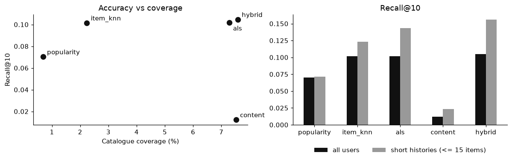
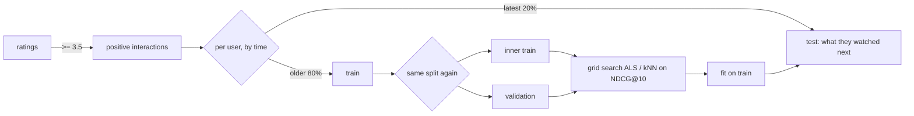

# recommender-system

[](https://github.com/joaofrancowork/recommender-system/actions/workflows/ci.yml)


Movie recommendations on MovieLens (100k ratings, 610 users, 9.7k movies), from a popularity
baseline to a **hybrid of implicit ALS and content embeddings**. ALS is implemented from scratch
and evaluated on each user's *future*. The repo includes an analysis notebook and a FastAPI
service that also serves brand-new users without retraining.



## Quick start

```bash
git clone https://github.com/joaofrancowork/recommender-system && cd recommender-system
uv sync --extra embeddings
uv run recsys train --tune   # downloads MovieLens, tunes on validation, evaluates, saves artifacts/
uv run recsys serve          # http://localhost:8000/docs
```

Or `docker build -t recsys . && docker run -p 8000:8000 recsys`: the image trains in a build
stage and ships only the artifacts. The analysis is in
[notebooks/analysis.ipynb](notebooks/analysis.ipynb).

## Models

| Model | Idea | Why it is here |
|---|---|---|
| `popularity` | Most-liked items | The baseline to beat, and the cold-start fallback |
| `item_knn` | Item-item cosine with shrinkage, top-N neighbours per item | Strong, explainable ("because you liked X") |
| `als` | Implicit-feedback matrix factorisation (Hu, Koren & Volinsky, 2008), **from scratch** | Captures latent taste; recommends far more of the catalogue |
| `content` | Mean `bge-small` embedding of a user's liked movies (title, genres, tags) | Works for items and users with little or no interaction data |
| `hybrid` | z-scored ALS + content, with the content weight decaying as history grows: `w = 1 / (1 + n / 10)` | Content where CF is weak, CF where it is strong |

ALS alternates closed-form ridge solves. The per-user system uses
`Yᵀ C_u Y = YᵀY + Yᵀ(C_u − I)Y`, so each solve only touches the items that user interacted
with. The same solve gives **fold-in**: a new user who likes three movies gets latent factors
in one step, with no retraining.

## Evaluation



Random hold-out lets a model learn from the future and inflates every metric, so each user's
latest interactions are held out instead. Hyper-parameters are tuned on a second temporal split
*inside* the training period, so the test period is used once.

Test results, tuned (`recsys evaluate --tune`):

| Model | Recall@10 | NDCG@10 | Coverage | Novelty (bits) | Recall@10, short histories |
|---|---|---|---|---|---|
| popularity | 0.070 | 0.069 | 0.7% | 8.3 | 0.072 |
| item_knn | 0.101 | **0.092** | 2.2% | 8.9 | 0.123 |
| als | 0.102 | 0.087 | 7.3% | 9.6 | 0.143 |
| content | 0.012 | 0.010 | 7.5% | 14.0 | 0.023 |
| **hybrid** | **0.105** | **0.092** | **7.6%** | 9.6 | **0.156** |

- **Accuracy alone would pick item-kNN**, but it recommends from only 2.2% of the catalogue.
  ALS and the hybrid match it while covering more than three times as many titles.
- **Short histories** (107 users with ≤ 15 training items) are where the hybrid earns its keep:
  +0.013 over ALS and more than double the popularity baseline.
- **Content alone is weak** (taste is not only genre), which is why it is a component, not a
  model to ship.
- CI re-runs the pipeline on the real data and fails if ALS or the hybrid stops beating
  popularity by at least 20%.

## API

```bash
curl -s "localhost:8000/users/1/recommendations?k=5&model=hybrid"
curl -s -X POST localhost:8000/recommendations -H 'content-type: application/json' \
     -d '{"liked_movie_ids": [1, 6377, 4306], "k": 5}'   # Toy Story, Finding Nemo, Shrek
curl -s "localhost:8000/movies/2571/similar?k=5"          # The Matrix
```

Every recommendation carries a reason, taken from the strongest item-kNN link to the user's
history. For the new user above:

```text
Monsters, Inc. (2001)     because you liked Finding Nemo (2003)
Toy Story 3 (2010)        because you liked Finding Nemo (2003)
Shrek 2 (2004)            because you liked Shrek (2001)
Toy Story 2 (1999)        because you liked Toy Story (1995)
Incredibles, The (2004)   because you liked Finding Nemo (2003)
```

| Endpoint | Description |
|---|---|
| `GET /users/{id}/recommendations?model=hybrid\|als\|item_knn\|popularity` | Known users; seen items are excluded |
| `POST /recommendations` | New users from a list of liked movies (ALS fold-in + content) |
| `GET /movies/{id}/similar` | Item-to-item neighbours |
| `GET /health` | Users and items loaded |

## Engineering

- Sparse matrices end to end (SciPy CSR); `argpartition` top-k; a pruned item-similarity matrix.
- `mypy --strict`, ruff, 99% test coverage on a small synthetic dataset with planted taste
  clusters, so tests check *behaviour* (CF beats popularity; fold-in recovers the genre), not
  just that the code runs.
- Docker multi-stage build that trains at build time; CI with lint, types, tests on 3.11 and
  3.12, a data quality gate and an API smoke test.

## Roadmap

- [ ] BPR and a two-tower model on the same evaluation
- [ ] Item cold start: evaluate on movies with no training interactions
- [ ] Re-ranking for diversity (MMR) with a measured accuracy cost
- [ ] Approximate nearest neighbours (FAISS) for larger catalogues

## Data and licence

Code: MIT. Data: [MovieLens latest-small](https://grouplens.org/datasets/movielens/) by GroupLens
Research, used under its terms (research use, no redistribution; downloaded at run time).
F. M. Harper and J. A. Konstan, *The MovieLens Datasets: History and Context*, ACM TiiS, 2015.
